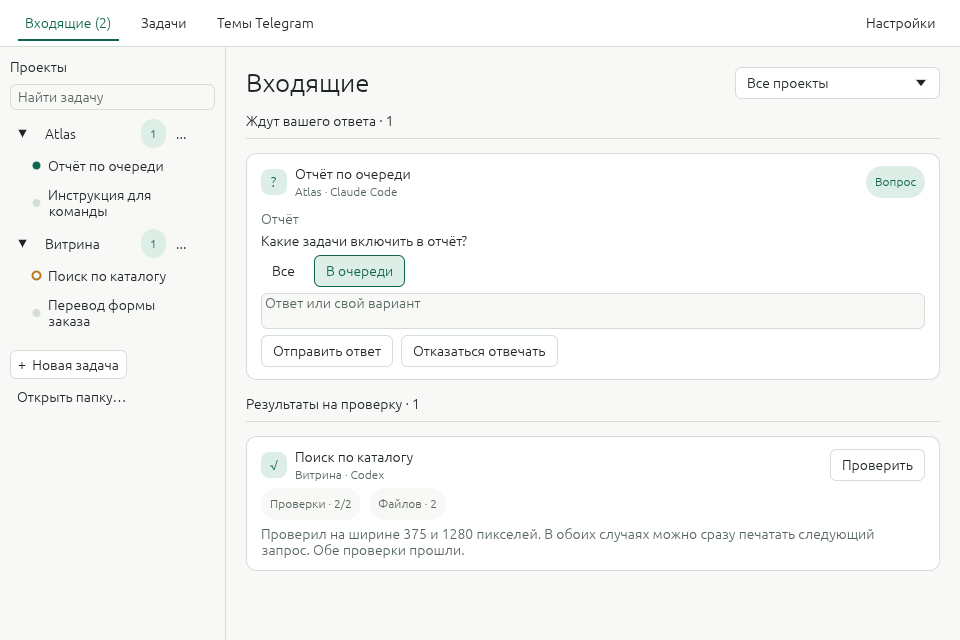

# Agent Hub

Agent Hub запускает Claude Code, Codex, Qwen Code, Hermes, OpenCode и Pi в ваших проектах. У каждой задачи свой чат. Вопросы, запросы разрешений и готовые результаты из разных проектов попадают в одни «Входящие». Начать можно на компьютере, а продолжить — с телефона в Telegram.

**[Скачать для Windows, macOS и Linux](https://github.com/aprazdnikov/agent-hub-rs/releases/latest)** · [Что нового в 1.1.2](https://github.com/aprazdnikov/agent-hub-rs/releases/tag/v1.1.2) · [Полное руководство](https://github.com/aprazdnikov/agent-hub-rs/blob/v1.1.2/docs/README.md) · [Сайт](https://aprazdnikov.github.io/agent-hub-rs/)

## Первая задача на компьютере

1. Установите приложение и войдите в CLI хотя бы одного агента. Подойдут Windows x64, macOS на Apple Silicon или Intel и Linux x64. [Инструкция по установке и требования](https://github.com/aprazdnikov/agent-hub-rs/blob/v1.1.2/docs/guide/getting-started.md)
2. В хабе нажмите «Открыть папку…», выберите проект и нажмите «Новая задача». Выберите «Локально» и агента. Для первого запуска подойдёт поручение «Прочитай README и объясни, как запустить проект». Нажмите «Начать задачу».
3. Ответьте агенту во «Входящих». Когда появится результат, нажмите «Проверить», посмотрите ответ, файлы и изменения. Дальше можно принять результат или отправить замечание в чат. [Подробнее о задачах](https://github.com/aprazdnikov/agent-hub-rs/blob/v1.1.2/docs/guide/tasks.md)

Чтобы говорить с агентом в терминале — на сервере, по SSH или на Raspberry Pi — запустите `agent-hub --cli`. [Консольный режим](docs/guide/console.md)

Telegram подключается по желанию. Создайте бота, добавьте его в группу с темами и укажите разрешённых пользователей в «Настройки → Telegram и доступ». Чтобы получать вопросы и результаты уже начатой задачи, отправьте `/task follow ID` в теме того же проекта. [Настройка Telegram](https://github.com/aprazdnikov/agent-hub-rs/blob/v1.1.2/docs/guide/getting-started.md#telegram)

## Что ещё умеет хаб

| Что вы хотите сделать | Где посмотреть |
|---|---|
| После изменений запустить тесты и передать результат агенту-ревьюеру | [Правила проекта и автоматические проверки](https://github.com/aprazdnikov/agent-hub-rs/blob/v1.1.2/docs/guide/tasks.md#automation) |
| Поставить задачи в очередь или параллельно работать в отдельных Git worktree | [Очередь и рабочие копии](https://github.com/aprazdnikov/agent-hub-rs/blob/v1.1.2/docs/guide/tasks.md#queue) |
| Передать решения и контекст между агентами, включить память для задачи или темы | [Память проекта](https://github.com/aprazdnikov/agent-hub-rs/blob/v1.1.2/docs/guide/memory.md) |
| Отправлять файлы и голосовые, восстановить сессию или посмотреть журнал | [Каталог руководств](https://github.com/aprazdnikov/agent-hub-rs/blob/v1.1.2/docs/README.md) |
| Говорить с агентом в терминале без окна — сервер, SSH, Raspberry Pi | [Консольный режим](docs/guide/console.md) |

Агенты работают с правами вашей учётной записи. Доступные файлы и действия зависят от настроек CLI и проекта. [Права доступа и хранение данных](https://github.com/aprazdnikov/agent-hub-rs/blob/v1.1.2/docs/guide/security.md)

[Сборка из исходников и разработка](https://github.com/aprazdnikov/agent-hub-rs/blob/v1.1.2/docs/development.md) · [Лицензия MIT](https://github.com/aprazdnikov/agent-hub-rs/blob/v1.1.2/LICENSE)

