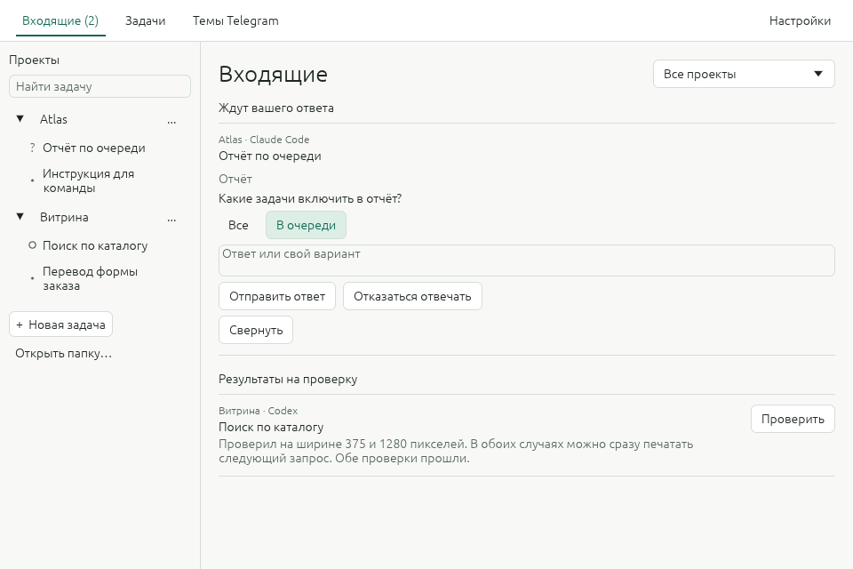
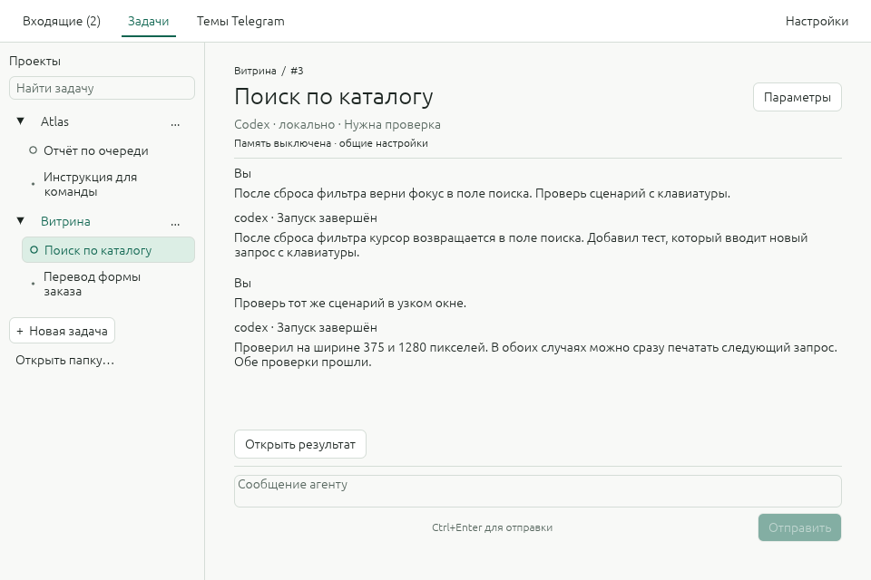

# Задачи, чат и проверка результатов

[Документация](../README.md) · [Первая задача](getting-started.md#first-task)

У каждой задачи есть номер, каталог проекта, поручение, назначенный агент и история
попыток. Откройте её из дерева проектов на компьютере или по номеру через `/task get ID`
в теме Telegram того же проекта.

- [Входящие и проверка результата](#inbox) · [Чат и локальный запуск](#task-chat)
- [Продолжение в Telegram](#начать-на-компьютере-продолжить-в-telegram) · [Смена агента](#передать-другому-агенту-и-проверить-контекст)
- [Правила проекта](#правила-проекта) · [Подготовка Git](#проверяемая-подготовка-git)
- [Автоматическая проверка и ревью](#automation) · [Очередь и отдельные рабочие копии](#queue)
- [Поиск и архив](#статус-поиск-и-архив) · [Хранение и ограничения](#хранение-и-ограничения)

<a id="inbox"></a>

## Входящие и проверка изменений

При запуске хаб открывает «Входящие». Здесь собраны вопросы агентов, запросы разрешений,
остановки очереди, ошибки Git и проверок, а также готовые результаты. Фильтр «Все проекты»
позволяет оставить один проект. Чтобы ответить прямо в списке, нажмите «Ответить» или
«Посмотреть запрос». Ответ также закрывает запрос в связанной теме Telegram.



Нажмите «Проверить», чтобы прочитать результат и посмотреть файлы, изменения и проверки.
«Принять результат» помечает задачу как принятую. «На доработку» открывает
поле сообщения в чате. Если вы пришли из входящих, после приёмки или отправки замечания хаб вернёт вас к списку.
К тому же результату можно перейти в любое время из чата кнопкой «Открыть результат».

Дерево слева открывает чаты задач. При выборе проекта хаб возвращает к последней
выбранной в нём задаче. В узком окне дерево открывается кнопкой «Проекты».
Агент может передать файл из рабочего каталога через `send_file`. Хаб сохраняет копию,
доступную после перезапуска и удаления рабочего дерева. Для TXT, PDF, PNG, JPEG и WebP
доступно «Открыть файл», для любого вложения — «В папке». Вложения прежних запусков
находятся в «Истории попыток». Одна попытка принимает до 32 файлов размером до 50 МиБ каждый.

«Изменения» показывает сохранённый при завершении попытки diff относительно HEAD
перед её запуском. Если рабочая копия уже содержала правки, они тоже видны.
Для новых неотслеживаемых файлов сохраняются имена. Размер вывода ограничен,
для старых запусков снимка может не быть. Нажмите добавленную или удалённую
строку, напишите замечание и нажмите «Добавить в следующий шаг». Черновик можно
дополнить и проверить перед отправкой. Когда запустите продолжение, исполнитель
получит текст замечания, путь, номер строки, фрагмент и номер попытки.

Разверните «Проверки», чтобы увидеть вывод команды и заключение ревьюера.
«История попыток» показывает предыдущие поручения, результаты, проверки и сохранённые изменения.

<a id="task-chat"></a>

## Локальное управление без Telegram

Выберите проект в дереве или нажмите «Открыть папку…». Нажмите «Новая задача»,
выберите «Локально» и агента, затем введите поручение. Название берётся из первой
строки поручения. При желании его можно задать отдельно.
«Начать задачу» сохраняет поручение и запускает агента. «Сохранить черновик»
оставляет задачу для последующего запуска. Токен, запущенный бот и тема не нужны.
Если настроен корень проектов, выбранная папка должна находиться внутри него.

Доступны создание, назначение агента, поиск, статусы, архив, правила проекта,
предпросмотр контекста и история попыток.
GUI и Telegram видят одни задачи выбранного каталога. Подключение бота не меняет
выбранный режим. Набранное сообщение остаётся в чате соответствующей задачи при
переключении между проектами, пока приложение открыто и история задачи актуальна.

До первого запуска текст сохранённого черновика можно изменить прямо в чате.
«Сохранить» записывает правки, а «Запустить» сохраняет поручение и передаёт его агенту.
Чтобы посмотреть, что получит агент, откройте «Параметры» → «Контекст следующего запуска».
После результата введите следующее сообщение внизу чата и нажмите «Отправить».



Настольное приложение и подключённый бот используют общий исполнитель. Бота можно
подключить во время задачи, и он получит доступ к уже запущенной попытке.
Создание и просмотр других задач остаются доступны. Git подготовка и проверка
временно блокируют изменения задач и правил; чтение остаётся доступным.

В параметрах активной задачи можно остановить локальную работу. Запросы разрешений,
вопросы с вариантами и свободным ответом появляются во входящих и в чате задачи.
Отказ, остановка или истечение времени ожидания не дают разрешение.
Настройки режима разрешений самого CLI применяются как прежде: при выбранном
пользователем автоматическом режиме CLI может не запрашивать подтверждение.

Каждая попытка управляемой задачи начинает свежую CLI-сессию и получает сохранённый контекст
задачи, последние сообщения и включённые правила. История CLI-сессии Telegram
и прежние разрешения не переносятся. Используются сохранённые настройки агентов;
без файла настроек — значения по умолчанию и CLI из PATH. Вход в аккаунт провайдера
выполните средствами выбранного CLI. Чтобы сохранить настройки агентов без бота, укажите корень проектов и оставьте
поля токена, группы и пользователей Telegram пустыми.
Хаб сохраняет шаги, итоговые ответы и переданные агентом файлы.

Настройки исполнения фиксируются при запуске. Изменения применяются к следующей
попытке. Общая задача продолжает выполняться при остановке или переподключении бота.
При полном выходе приложение прерывает текущую попытку. После перезапуска
проверьте её результат перед продолжением. Ожидающие заявки остаются в [очереди](#queue).
Для выполнения через Telegram выберите режим «В теме Telegram» и тему того же
проекта с назначенным агентом.

## Начать на компьютере, продолжить в Telegram

1. Запустите задачу на компьютере. Её номер виден над названием в чате.
   Оставьте приложение и компьютер включёнными, с доступом к сети.
2. Подключите бота. В Telegram выберите тему **того же каталога проекта** и отправьте
   `/task follow ID` с фактическим номером. Подписка показывает текущий статус,
   вопросы, разрешения и результат; новый процесс агента не запускается.
3. Разрешение подтвердите или отклоните кнопкой. На вопрос ответьте **ответом на
   последнюю карточку**; для нескольких вопросов — по одному ответу на строку.
   Ответы принимает пользователь, включивший подписку в этой теме. Ответ в GUI
   закрывает тот же запрос в Telegram, и наоборот; второй ответ отклоняется.
4. После завершения ответьте на текущую карточку результата сообщением со следующим шагом.
   Для запуска используйте тему с тем же проектом и назначенным агентом. Можно также
   взять ревизию из `/task get ID` и отправить `/task resume ID РЕВИЗИЯ Следующий шаг`.
   Хаб сохранит поручение и начнёт новую попытку. При запуске из Telegram подписка включается автоматически.
5. `/task unfollow` отключает доставку в тему, сохраняя выполнение. После перезапуска
   бота отправьте `/task follow ID` повторно. Последний сохранённый результат всегда
   доступен через `/task get ID`, в том числе после перезапуска приложения.

Кнопка остановки привязана к карточке. Команда `/stop` в подписанной теме
останавливает связанную задачу. Из темы без подписки можно остановить единственную
активную задачу того же проекта. Если их две, привяжите тему к нужному ID через `/task follow ID`.
`/task git-stop` отменяет только фазу подготовки/проверки Git до запуска агента.
Смена проекта или параметров темы отключает её подписку; подключите её заново.
Изменение доступа пользователя прекращает дальнейшую доставку и приём ответов.

Слишком большой вопрос или запрос разрешения нужно прочитать и обработать в GUI:
в Telegram останутся только отказ и остановка. При ошибке доставки карточка
повторяется до трёх попыток с задержкой; это не повторяет действие агента. При
неопределённом сетевом результате возможна лишняя копия сообщения, но действуют
только кнопки последней подтверждённой карточки. Если карточка не появилась,
повторите `/task follow ID`. Сообщение, уже принятое Telegram до отключения, отозвать нельзя.

## Создать и запустить

В режиме «В теме Telegram» запустите бота и выберите существующую тему с нужными каталогом и агентом.
В GUI нажмите «Новая задача», выберите «В теме Telegram» и нужную тему.
Введите поручение и нажмите «Начать задачу» либо «Сохранить черновик».

В Telegram в выбранной теме:

```text
/task create Проверка README | Прочитай README.md, назови первый заголовок. Ничего не изменяй.
/task
/task get 1
/task run 1 1
```

Замените ID и ревизию числами из фактической карточки. Поручение может быть многострочным:
переносы, отступы и внутренние пробелы сохраняются. Между `|` и поручением можно поставить
один разделительный пробел. Название очищается от внешних пробелов.

Запуск разрешён только в теме с тем же каталогом и агентом, что указаны в задаче.
Проверяется актуальная ревизия; повтор команды со старой ревизией не создаёт второй
запуск. Для отложенного запуска поставьте задачу в очередь. Обычные управляемые
задачи выполняются последовательно, изолированные могут работать в отдельных worktree.
Перед запуском общей задачи завершите текущие обычные сессии и операции. Разрешения и вопросы доступны в обоих интерфейсах.

## Результат и продолжение

В Telegram у подписанной темы после завершения попытки появляется карточка. «Принять»
отмечает задачу принятой, «Открыть diff» отправляет сохранённые изменения, «Вернуть
с замечанием» предлагает ответить текстом на карточку результата. Подтверждённое
замечание запускает следующую попытку. Кнопки привязаны к пользователю, теме и ревизии
задачи. В автоматическом сценарии карточка содержит итог каждой проверки и выдержку
из ревью; команда в карточке открывает подробный отчёт.

История показывает состояния попыток: «Выполняется», «Запуск завершён», «Ошибка»,
«Прерван; проверьте результат». Завершение запуска не является приёмкой задачи человеком.
Последний текстовый ответ сохраняется отдельно от полного разговора, до 64 КиБ.
Если ответ больше, сохраняется причина отсутствия текста; содержимое не обрезается молча.
В GUI доступны шаги, результаты и диагностика всех попыток. В Telegram карточка показывает
состояния всех попыток и текст последней. Для прежнего текста используйте
`/task attempt ID НОМЕР_ПОПЫТКИ` — шаг, результат и диагностика сохраняются полностью.

Чтобы остановить выполнение, откройте «Параметры» в чате задачи и нажмите
«Остановить локальную работу» либо отправьте `/stop` в связанной теме.
Дополнительные сообщения, вложения и голосовые во время управляемого
запуска не ставятся в очередь нового поручения. Ответы на запросы разрешений и вопросы
агента остаются доступны.

Для новой попытки после остановки, ошибки или успешного результата укажите следующий шаг.

```text
/task resume 1 3 Проверь, что предыдущий шаг действительно выполнен. Затем назови разделы README, ничего не изменяя.
```

Чат задачи показывает шаги и ответы по порядку, с именем исполнителя и состоянием каждой попытки. Откройте задачу после перезапуска приложения, чтобы вернуться к той же переписке. Во время работы ответ обновляется по мере получения сообщений от CLI. Следующее сообщение можно набрать под перепиской, пока агент работает. После завершения нажмите «Отправить» или Ctrl+Enter (на macOS — ⌘+Enter). Enter добавляет новую строку.

Перед отправкой откройте «Параметры» → «Контекст следующего запуска». Агент получает исходное поручение, новое сообщение и целиком последний шаг с ответом. Для более ранних сообщений предусмотрено ещё 16 КиБ контекста. Полные сохранённые ответы остаются в карточке задачи.

## Передать другому агенту и проверить контекст

Передача меняет назначенного агента у той же задачи; ID, поручение и результаты
сохраняются. Она сама по себе не запускает модель. В каждой попытке виден её агент,
в том числе после повторной передачи. Прежние попытки без поля исполнителя
привязываются к исходному агенту до первого переназначения.

В GUI откройте «Параметры» в чате задачи, выберите исполнителя и нажмите «Назначить».
В режиме Telegram для отправки сообщения выберите тему того же проекта с назначенным агентом.

Введённый текст сохраняется при переключении темы в том же проекте и при назначении, если история задачи не изменилась.

В Telegram в теме проекта:

```text
/task assign ID РЕВИЗИЯ qwen
/task get ID
/task preview ID Проверь прежний результат, затем продолжи работу
```

Назначать можно `codex`, `claude`, `qwen`, `hermes`, `opencode`. Используйте фактические
ID и ревизию из карточки. `/task preview ID` без следующего шага подходит только
для задачи без попыток. Длинный предпросмотр приходит с номерами «часть i/N»; перед запуском проверьте,
что получены все N частей. Далее перейдите в тему того же каталога с назначенным
агентом и выполните `/task resume ID НОВАЯ_РЕВИЗИЯ ТЕКСТ_ШАГА`. Текст шага должен
совпадать с тем, который вы проверили. В прежней теме запуск будет отклонён.

Предпросмотр показывает полный текст поручения хаба: цель, назначенного агента,
новый шаг, последний сохранённый ответ и ограничения продолжения. Его генератор
общий с запуском. Это снимок указанной ревизии. Если задача успеет измениться,
обновите карточку. Получатель начинает свежую CLI-сессию. К поручению могут добавиться
инструкции CLI и сведения из включённой памяти проекта. Запросы разрешений
относятся к новой попытке и доступны в приложении и подписанной теме.

Выполняющуюся или архивную задачу передавать нельзя. Принятую/отложенную сначала
верните в «Запланирована». Ошибка записи не подтверждает назначение; прежняя
история не удаляется. В старом заполненном файле фиксация исполнителей может
упереться в лимит объёма — тогда передача отклоняется до записи.

Правила проекта и подготовка Git описаны ниже. Предпросмотр включает текущую
редакцию включённых правил.

## Статус, поиск и архив

Статус задачи отделён от состояния попытки: «Запланирована», «Нужна проверка»,
«Принята», «Отложена». После завершения, ошибки или восстановления прерванного
запуска задача требует проверки. Успех модели не устанавливает приёмку.
В GUI откройте «Параметры» → «Управление задачей» и выберите статус.
Из принятой или отложенной задачи сначала вернитесь в «Запланирована».

«В архив» скрывает задачу из обычного списка без удаления истории. Выберите фильтр
«Архив» и нажмите «Восстановить из архива», чтобы вернуть её. Во время выполнения
статус и архив менять нельзя. Архивные задачи учитываются в лимите 100 задач.
В поле «Найти задачу» в дереве проектов можно ввести название проекта, задачи,
фрагмент поручения или номер в виде `#12`. Поиск учитывает русский текст без учёта регистра.
Фильтры статуса исключают архив; «Все, включая архив» показывает обе группы.

Telegram (подставьте ID и текущую ревизию из карточки):

```text
/task list README
/task list review README
/task list all
/task list archived
/task status 1 3 accepted
/task status 1 4 planned
/task archive 1 5
/task restore 1 6
/task attempt 1 1
```

Статусы команд: `planned` — запланирована, `review` — нужна проверка,
`accepted` — принята, `deferred` — отложена. `/task` и `/task list` скрывают архив;
`/task get ID` и `/task attempt ID НОМЕР` доступны и для архивных задач своего проекта.
Поиск может быть многострочным; без фильтра ищет среди всех неархивных задач.
Первое слово `all`, `archived` или код статуса считается фильтром. Ошибка сохранения не подтверждает
изменение; старая ревизия отклоняется, нужно обновить карточку.

Прежние файлы читаются без потери истории: задачи без попыток считаются
запланированными, с попытками — требующими проверки. Файл по-прежнему версии 1,
необязательные поля статуса и архива добавляются для явно изменённых значений.
Новые попытки также содержат исполнителя; перед переназначением он фиксируется
у старых попыток. Старое приложение 1.0.0 отвергнет файл с новыми полями; перед
возвратом на прежнюю версию сохраните резервную копию, не удаляйте новые поля вручную.

## Удалить задачу

В чате задачи откройте «Параметры» → «Управление задачей» → «Удалить задачу». Подтверждение удаляет переписку, попытки и сохранённые хабом копии вложений. Исходные файлы проекта, Git worktree и общая память проекта сохраняются. Активную задачу сначала остановите, ожидающую снимите с очереди. Архивирование позволяет вернуть карточку позже.

В Telegram выполните `/task delete ID РЕВИЗИЯ`. Хаб вернёт команду подтверждения с `confirm`. Ответ на карточку удалённой задачи больше не запускает агента.

## Перезапуск и ошибки

Перед запуском модели сохраняется намерение выполнить попытку. Если приложение
завершилось до сохранения конечного состояния, при следующем запуске приложения попытка
становится прерванной. Автоматического перезапуска модели нет. Проверьте файлы и другие
эффекты прежней попытки, затем сформулируйте следующий шаг. Хаб предотвращает
автоматический повтор запуска, но не гарантирует однократность внешних действий модели
после аварии.

При ошибке сохранения запуск не начинается; при неопределённом результате записи
операции задач блокируются до полного перезапуска приложения. Сначала проверьте прежние эффекты.
Отказ из-за лимита данных не повреждает историю и не блокирует чтение.
Во время выдачи карточек Telegram доступ перепроверяется перед каждой частью;
при смене разрешений или остановке бота дальнейшая выдача прекращается.
Уже отправленную часть нельзя отозвать таким способом.

## Хранение и ограничения

Хаб записывает состояние задач в `topics.tasks.json` рядом с `topics.json`, а
копии выданных агентами файлов — в `task-files/` в том же каталоге данных. Настольное
приложение и Telegram читают и изменяют общие задачи. Для резервной копии закройте
хаб и сохраните файл задач вместе с каталогом вложений. Снимок сессии `/save`
и экспорт памяти сохраняют свои данные отдельно. [Пути для каждой ОС](settings.md#настройки-и-файлы)

Хранилище вмещает до 100 задач суммарно по всем проектам и до 32 попыток на задачу.
Название занимает до 256 байт, поручение и следующий шаг — до 16 КиБ каждый,
ответ — до 64 КиБ. Для JSON отведено 8 МиБ плюс 1 КиБ служебного резерва
на восстановление. При нехватке места хаб сначала уплотняет форматирование.
Архив сохраняет историю и занимает место. Освободить его можно [удалением задачи](#удалить-задачу).

Сохраняются поручения и итоговые ответы, без автоматического удаления секретов из текста:
не включайте секреты в поручение и не просите модель выводить их. Полный диалог не копируется.
Записи памяти и задачи — разные данные: Move/Share памяти не меняют каталог задачи.
Доступ локальный для одного пользователя ОС; удалённый сетевой сервис не добавлен.

## Правила проекта

В дереве слева откройте меню рядом с названием проекта и выберите «Правила проекта». Введите инструкции,
отметьте «Добавлять правила к каждому запуску» и нажмите «Сохранить правила».
Они общие для всех задач выбранного каталога, по умолчанию выключены. Текст —
до 16 КиБ; хранятся правила максимум для 100 каталогов в том же файле задач.
Не сохраняйте пароли, токены и другие секреты.

Несохранённый черновик блокирует GUI-запуск. Фоновое обновление не заменяет
вводимый текст. Если правила изменили в другой сессии, скопируйте нужные части
черновика и нажмите «Загрузить сохранённую редакцию»; затем внесите правку снова.
Эта кнопка заменяет черновик актуальным сохранённым текстом.

«Контекст следующего запуска» показывает включённые правила и их редакцию.
GUI откажет в запуске, если редакция успела измениться после предпросмотра.
В истории попытки сохраняется снимок правил, который не меняется при дальнейших
правках. Для старых запусков и запусков до настройки правил редакция неизвестна.
Смена проекта загружает отдельные правила и убирает несохранённый черновик прежнего.

Telegram:

- `/task rules` — прочитать текущую редакцию и сохранённый текст;
- `/task rules-set 0 on | Текст правил` — впервые сохранить и включить;
- `/task rules-set 1 off | Текст правил` — выключить с проверкой редакции 1;
- `/task preview ID [Следующий шаг]` — посмотреть поручение с текущими правилами.

Telegram `/task run` и `/task resume` применяют текущую сохранённую редакцию
на момент команды. Правка правил не меняет уже запущенное поручение.

**Текстовые инструкции и выполнение Git включаются отдельно.** Для проверяемой
подготовки используйте настройку ниже; одного упоминания Git в тексте недостаточно.


## Проверяемая подготовка Git

В «Правилах проекта» включите «Требовать подготовку Git перед новой задачей»,
укажите имя remote (например, `origin`) и точное имя базы (`Dev`, `master`, `main`
или другое). Нажмите «Сохранить правила». Регистр значим. Для этого механизма
имена ограничены латиницей, цифрами, `-`, `_`, `.`, `/` (remote без `/`);
рабочая ветка не может совпадать с базой. Текстовые инструкции можно оставить
выключенными: настройка Git независима от них.

Создайте новую задачу. Подготовка доступна в локальном режиме
и в режиме «В теме Telegram», в том числе при подключённом боте.
В параметрах задачи появится «Подготовка Git». Укажите новое имя
рабочей ветки (предложение — `task/ID`) и нажмите «Подготовить ветку Git».
Это явное разрешение изменить Git выбранного проекта. Приложение:

1. Проверит текущий корень проектов, корень репозитория, чистоту каталога,
   незавершённые Git-операции, доступность worktree и отсутствие новой ветки.
2. Получит только выбранную базу из remote, без тегов, pruning и дополнительных
   настроенных refmap. Ошибка сети или авторизации останавливает подготовку.
3. Проверит возможность fast-forward. Локальная база впереди remote или
   разошедшаяся с ним требует ручного решения. База, открытая в другом worktree,
   и незавершённая операция в другом worktree запрещают подготовку.
4. Обновит локальную базу, создаст рабочую ветку и переключит каталог на неё.
   Существующие ветки не перезаписываются. `stash`, `reset`, `rebase`, `push`,
   Git hooks и рекурсивное обновление submodule не выполняются.
5. Сохранит результат и SHA базы. Агент автоматически не запускается.

После «Ветка подготовлена» проверьте контекст и отдельно нажмите запуск задачи.
Перед каждым запуском приложение проверяет выбранную ветку и происхождение от
сохранённой базы. Перед первым запуском также нужны чистое дерево и неизменный
SHA; для продолжения допускаются сохранённые агентом коммиты и незакоммиченные
результаты. Ошибка проверки не создаёт попытку и не стирает черновик следующего шага.

Подготовка и проверка ограничены двумя минутами. Кнопка остановки или `/task git-stop`
отменяет подготовку или проверку перед запуском в том же проекте. Настройки
текущей операции фиксируются при её запуске. Во время работы Git хаб не начинает другие агентные запуски,
передачу контекста, снимки сессий или локальные действия. Внешние терминалы и
программы хаб не блокирует — не меняйте тот же репозиторий одновременно.

При ошибке, остановке или перезапуске автоматического повтора нет. Часть действий
(fetch, обновление базы, создание ветки) могла успеть выполниться. Проверьте
`git status` и список веток. До первого агентного запуска можно задать **другое
новое имя** и повторить подготовку, сохранив прежнюю ветку.

Это механизм для новых задач. Для уже начатой задачи нельзя создавать новую ветку
через подготовку. Если включить требование Git у старой задачи без подготовки
или изменить её remote/base после начала работы, продолжение будет заблокировано:
используйте прежнюю настройку либо явно выключите требование для этого проекта.
Для нового remote/base создайте новую задачу.

Telegram использует те же проверки и хранилище:

- `/task git 0 origin Dev` — включить с проверкой редакции правил 0;
- `/task git 1 off` — выключить с проверкой редакции 1;
- `/task prepare ID РЕВИЗИЯ НОВАЯ_ВЕТКА` — начать подготовку;
- `/task git-stop` — остановить операцию текущей темы;
- `/task get ID` — прочитать статус, SHA и последнюю диагностику;
- `/task run ID РЕВИЗИЯ` — отдельно проверить ветку и запустить задачу.

Git требует установленный CLI и уже настроенную авторизацию: интерактивный ввод
пароля отключён, SSH запускается в BatchMode. Серверные данные и stderr Git не
пишутся в историю задач; сообщения ошибок описывают этап и нужное действие.

<a id="automation"></a>

## Исправить и проверить автоматически

В GUI откройте «Правила проекта», включите «Исправить и проверить автоматически»,
выберите исполнителя и ревьюера, введите доверенную команду (например,
`cargo test -p hub-app`) и нажмите «Сохранить правила». Команду задаёт владелец
компьютера в GUI. Она запускается в рабочем каталоге попытки через системную оболочку
с правами пользователя приложения. Перед включением убедитесь, что доверяете
коду и тестам этого проекта.

Запустите задачу, назначенную выбранному исполнителю, в GUI или обычной командой
`/task run`. Эта же настройка применяется к следующему ручному шагу (`/task resume`).
Для других исполнителей остаётся обычный запуск. Переключение агента или выключение
сценария применяется к будущим запускам; историю уже выполненной попытки можно
посмотреть в карточке задачи.

После успешного хода исполнителя хаб запускает команду. Ненулевой код выхода
передаёт исполнителю вывод для одного исправления и повторной проверки.
Отмена, ошибка запуска процесса или повторное падение проверки останавливают
сценарий. Успешная проверка запускает выбранного ревьюера в отдельной сессии
с исходной задачей, результатом, снимком изменений и выводом команды.
Ревьюеру поручено проверить изменения без редактирования; действуют его обычные
настройки прав. В истории сохраняются коды выхода и последние 4 КиБ каждого
потока вывода, а заключение ревьюера хранится отдельно от ответа исполнителя.
Затем задача ожидает решения человека. Перезапуск приложения не переигрывает
прерванную попытку.

<a id="queue"></a>

## Очередь и отдельные рабочие копии

В чате задачи откройте «Параметры» и выберите «В очередь». Задачи запускаются в порядке постановки,
когда освобождается исполнитель. Очередь хранится на диске. В Telegram доступны
`/task queue ID РЕВИЗИЯ [следующий шаг]` и `/task unqueue ID РЕВИЗИЯ`.
Для повторной попытки укажите следующий шаг. Хаб проверяет ревизии задачи и правил
перед выполнением. После изменения правил или ошибки подготовки снимите запись
с очереди, прочитайте диагностику и проверьте контекст перед новой постановкой.

«В очередь в отдельном worktree» или `/task worktree ID РЕВИЗИЯ [следующий шаг]`
запускает задачу в ветке `hub/task-ID` от текущего закоммиченного HEAD проекта.
Рабочая копия находится в `.agent-hub-worktrees/ID`. Хаб сохраняет её после
завершения, включая незакоммиченные результаты. В следующих попытках та же
задача использует ту же копию. Режим выбирается до первой попытки. Для
такой работы нужен Git-репозиторий с коммитом. Итоговую ветку можно проверить и
объединить с нужной веткой вручную. Для проектов с обязательной подготовкой ветки
от настроенного remote используйте обычную очередь.

До двух задач в отдельных worktree могут выполняться одновременно. Обычная
задача занимает исполнителя целиком. Если первой в очереди стоит обычная
задача, следующие ждут её. Для независимых worktree из одного проекта
свяжите разные темы с нужными задачами через `/task follow ID`.
Разрешения, ответы и остановка относятся к выбранному запуску.

После перезапуска приложения ожидающие заявки сохраняются. Запущенная попытка
получает статус прерванной. Если остановка произошла между принятием заявки
и запуском агента, она останется в очереди с диагностикой; проверьте Git
перед повтором. Заявки, отправленные через тему, ждут подключения Telegram:
хаб повторно проверяет группу, доступ автора, каталог и агента темы.
