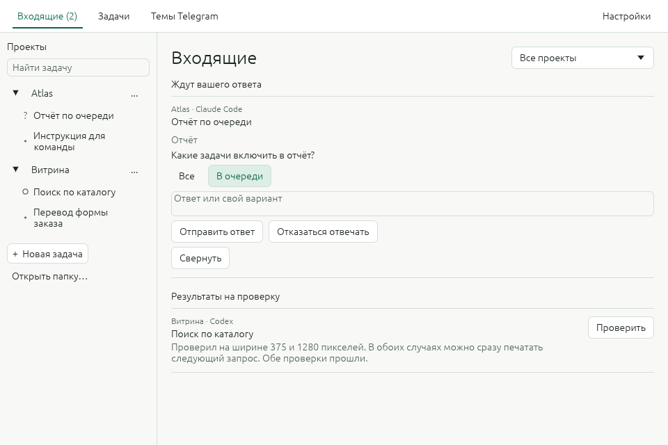

# v1.1.0 — задачи на компьютере и в Telegram

Теперь задачу можно создать, выполнить и принять целиком на компьютере. Если нужно отойти, подключите к ней тему Telegram и ответьте агенту с телефона. Оба интерфейса показывают одну задачу с тем же номером, исполнителем и историей попыток.



## От поручения до результата

1. Установите CLI выбранного агента и настройте его доступ к модели. На компьютере нажмите **«Открыть папку…» → «Новая задача» → «Локально»**. Выберите агента, введите поручение и нажмите **«Начать задачу»**. Чтобы сохранить настройки без Telegram, укажите корень проектов и оставьте поля токена, группы и пользователей пустыми.
2. Во **«Входящих»** собраны вопросы, запросы разрешений и готовые результаты по всем проектам. Чтобы получать их на телефоне, оставьте хаб запущенным и отправьте `/task follow ID` в теме того же проекта. Номер задачи виден в её чате. Ответ в любом из интерфейсов закрывает общий запрос. После перезапуска бота подпишитесь снова.
3. Откройте результат из входящих или чата задачи. В карточке видны ответ, сохранённые файлы, вывод проверок и изменения в Git. Снимок отсчитывается от коммита на старте попытки и включает прежние незакоммиченные правки. Для новых неотслеживаемых файлов видны только имена. Можно принять результат, вернуть замечание к строке или назначить следующую попытку другому агенту. В Telegram ответ подписавшегося пользователя на текущую карточку начинает следующий шаг той же задачи.

В дереве проектов можно найти задачу и вернуться к её переписке после перезапуска. Архивную задачу можно вернуть в список. Подтверждённое удаление стирает переписку, попытки и сохранённые хабом копии вложений. [Руководство по задачам](https://github.com/aprazdnikov/agent-hub-rs/blob/v1.1.0/docs/guide/tasks.md)

## Правила, проверки и очередь

- В меню проекта откройте **«Правила проекта»**. Включённые инструкции попадают в предпросмотр поручения и историю попытки. Для новой задачи можно потребовать подготовку Git. По вашей команде хаб проверит чистоту каталога, получит базовую ветку из выбранного удалённого репозитория и создаст рабочую ветку. Расхождение базы потребует ручного решения.
- В режиме **«Исправить и проверить автоматически»** выберите исполнителя, команду проверки и ревьюера. Команда выполняется в рабочем каталоге с правами вашего пользователя. При ненулевом коде выхода исполнитель получает вывод и одну попытку исправить ошибку. Повторная ошибка останавливает сценарий. После успешной проверки ревьюер читает результат и diff в отдельной сессии. Решение о приёмке остаётся за вами.
- Очередь сохраняется на диске. Обычные задачи выполняются по одной, а до двух независимых задач могут идти параллельно в отдельных Git worktree. Каждая получает ветку от текущего коммита и каталог `.agent-hub-worktrees/ID` внутри проекта. После перезапуска хаба проверьте изменения прерванной попытки и задайте следующий шаг вручную.

## Память проекта

При включённой памяти агент получает до четырёх выдержек из последних активных записей проекта. Хаб сохраняет краткий итог попытки со ссылкой на её историю, числом успешных проверок и отметкой о ревью. Режим памяти можно задать для задачи или темы. Для нового запуска сначала учитывается выбор задачи, затем темы, затем общая настройка. Изолированный worktree задачи использует память исходного проекта. [Руководство по памяти](https://github.com/aprazdnikov/agent-hub-rs/blob/v1.1.0/docs/guide/memory.md)

## Обновление с v1.0.0

Завершите работу агентов, закройте хаб через меню трея и остановите клиентов общей памяти. Скопируйте каталоги настроек и данных приложения. Задачи и история хранятся в `topics.tasks.json` рядом с `topics.json`, переданные агентами файлы — в соседнем каталоге `task-files/`. Стандартные пути зависят от системы.

| Система | Настройки | Данные |
|---|---|---|
| Windows | `%APPDATA%\agent-hub\config` | `%APPDATA%\agent-hub\data` |
| macOS | `~/Library/Application Support/agent-hub/` | тот же каталог |
| Linux | `~/.config/agent-hub/` | `~/.local/share/agent-hub/` |

На Linux при заданных `XDG_CONFIG_HOME` и `XDG_DATA_HOME` используйте каталог `agent-hub/` внутри соответствующего пути. Отдельно скопируйте весь каталог памяти `~/.agent-hub/memory/` вместе со скрытым `.projects/` (при собственном `--store-dir` скопируйте его). Для копии задач нужны сами файлы данных, даже если вы уже делали снимок `/save` или экспорт памяти.

v1.1.0 читает задачи v1.0.0. Прежние задачи без попыток получают статус «Запланирована», с попытками — «Нужна проверка». Файл задач сохраняет номер формата `"version": 1`. Правила проекта, очередь и результаты новых проверок добавляют поля, которые v1.0.0 отвергает. Для возврата к v1.0.0 восстановите копию, сделанную до обновления, при закрытом приложении. [Настройки, пути и обновление](https://github.com/aprazdnikov/agent-hub-rs/blob/v1.1.0/docs/guide/settings.md)

## Скачать и проверить

Скачайте файл для своей системы и его контрольную сумму в один каталог.

| Система | Файл | SHA-256 |
|---|---|---|
| Windows x64 | [Установщик .exe](https://github.com/aprazdnikov/agent-hub-rs/releases/download/v1.1.0/agent-hub-x86_64-pc-windows-msvc-setup.exe) · [переносимый .zip](https://github.com/aprazdnikov/agent-hub-rs/releases/download/v1.1.0/agent-hub-x86_64-pc-windows-msvc.zip) | [Установщик](https://github.com/aprazdnikov/agent-hub-rs/releases/download/v1.1.0/agent-hub-x86_64-pc-windows-msvc-setup.exe.sha256) · [архив](https://github.com/aprazdnikov/agent-hub-rs/releases/download/v1.1.0/agent-hub-x86_64-pc-windows-msvc.zip.sha256) |
| macOS, Apple Silicon | [Приложение .app.zip](https://github.com/aprazdnikov/agent-hub-rs/releases/download/v1.1.0/agent-hub-aarch64-apple-darwin.app.zip) | [Сумма](https://github.com/aprazdnikov/agent-hub-rs/releases/download/v1.1.0/agent-hub-aarch64-apple-darwin.app.zip.sha256) |
| macOS, Intel | [Приложение .app.zip](https://github.com/aprazdnikov/agent-hub-rs/releases/download/v1.1.0/agent-hub-x86_64-apple-darwin.app.zip) | [Сумма](https://github.com/aprazdnikov/agent-hub-rs/releases/download/v1.1.0/agent-hub-x86_64-apple-darwin.app.zip.sha256) |
| Debian / Ubuntu x64 | [Пакет .deb](https://github.com/aprazdnikov/agent-hub-rs/releases/download/v1.1.0/agent-hub-x86_64-unknown-linux-gnu.deb) | [Сумма](https://github.com/aprazdnikov/agent-hub-rs/releases/download/v1.1.0/agent-hub-x86_64-unknown-linux-gnu.deb.sha256) |
| Linux x64 с glibc 2.35+ | [Архив .tar.gz](https://github.com/aprazdnikov/agent-hub-rs/releases/download/v1.1.0/agent-hub-x86_64-unknown-linux-gnu.tar.gz) | [Сумма](https://github.com/aprazdnikov/agent-hub-rs/releases/download/v1.1.0/agent-hub-x86_64-unknown-linux-gnu.tar.gz.sha256) |

В каталоге загрузки проверьте сумму перед установкой. Подставьте имя выбранного файла.

- **Linux** — `sha256sum -c agent-hub-x86_64-unknown-linux-gnu.deb.sha256`. Ожидаемый результат — `OK`.
- **macOS** — `shasum -a 256 -c agent-hub-aarch64-apple-darwin.app.zip.sha256`. После `OK` распакуйте архив и замените весь `agent-hub.app`.
- **Windows PowerShell** — следующие команды вернут `True` при совпадении.

  ```powershell
  $file = 'agent-hub-x86_64-pc-windows-msvc-setup.exe'
  $expected = ((Get-Content -Raw -LiteralPath "$file.sha256") -split '\s+')[0]
  (Get-FileHash -Algorithm SHA256 -LiteralPath $file).Hash -eq $expected
  ```

Сборки Windows и macOS распространяются без подписи издателя. [Установка и первый запуск](https://github.com/aprazdnikov/agent-hub-rs/blob/v1.1.0/docs/guide/getting-started.md) · [Все изменения после v1.0.0](https://github.com/aprazdnikov/agent-hub-rs/compare/v1.0.0...v1.1.0)
