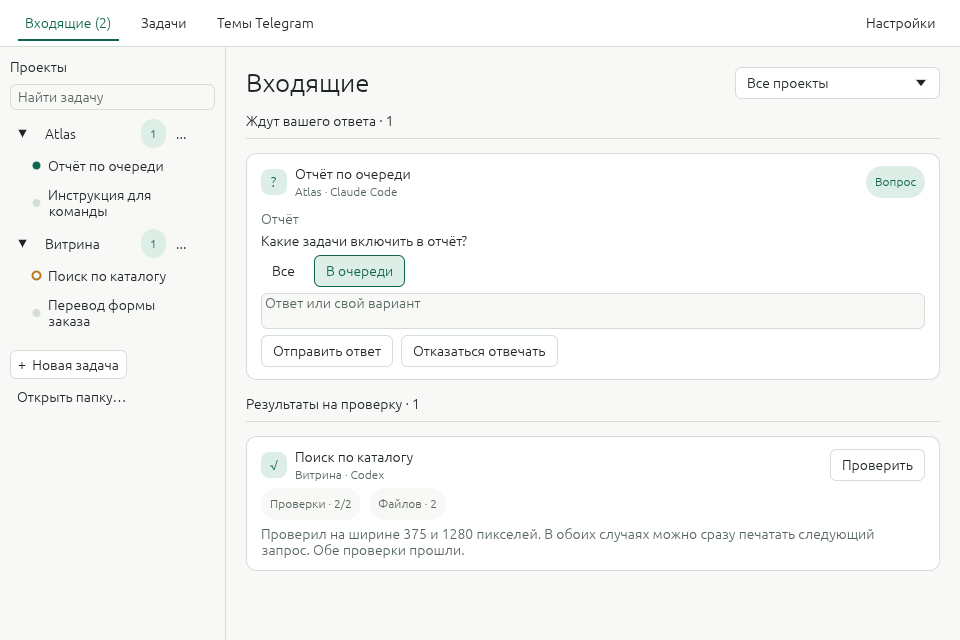
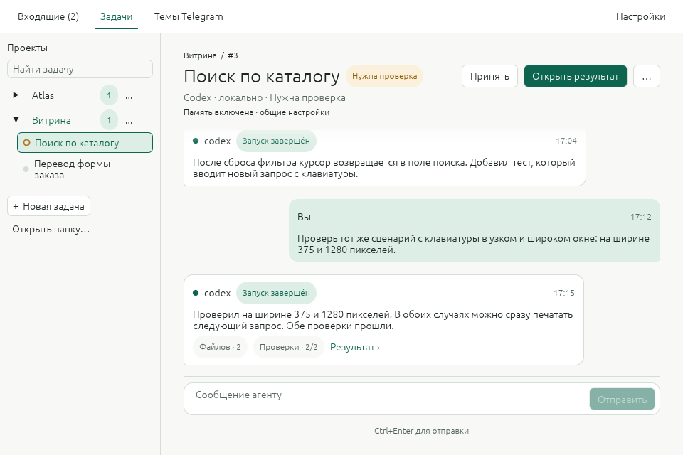

# v1.1.1 — обновлённый интерфейс и синхронизация тем

Патч-выпуск делает десктопный хаб удобнее в ежедневной работе: переписка задачи читается как чат, действия доступны без лишних раскрытий, состояния задач видны с первого взгляда. Разделы «Темы Telegram» и «Новая задача» обновлены в том же стиле. Логика задач, правила, проверки и Telegram-мост не изменились.



## Что изменилось в интерфейсе

- **Чат задачи.** Сообщения оформлены пузырями: ваши справа, агента слева, с именем исполнителя, статусом запуска и временем. Длинные ответы сворачиваются с кнопкой «Развернуть»; файлы и проверки показаны чипами. Поле сообщения растёт по мере набора (до 8 строк), отправка — Ctrl+Enter.
- **Входящие.** Вопросы и запросы разрешений оформлены карточками: варианты ответа и кнопки «Разрешить»/«Отклонить» доступны сразу, без раскрытия. Результаты на проверку — с чипами файлов и проверок.
- **Действия задачи.** Главное действие по состоянию — кнопкой в шапке чата («Остановить», «Открыть результат», «Снять с очереди», «Разобрать запуск»); редкие действия — в меню «…». Страница «Параметры» осталась для настроек.
- **Сайдбар.** Состояния задач отмечены цветными точками (выполняется, на проверке, ждёт ответа, ошибка), у проекта — счётчик требующих внимания.
- **Экран результата.** Вместо вложенных раскрытий — вкладки «Сводка», «Изменения», «Проверки», «Файлы», «История»; замечания к строкам diff сохраняются.
- **Темы Telegram.** Карточки с чипом состояния и этапа, меню «…» (память, параметры, папка, ссылка, session_id, сброс и удаление с подтверждением). Кнопка **«Синхронизировать»** убирает из списка темы, которых уже нет в Telegram.
- **Новая задача.** Компактная строка выбора проекта, режима и агента; растущее поле поручения; название — видимое опциональное поле.



## Удаление и синхронизация тем

- Удаление темы, которой уже нет в Telegram, больше не показывает ошибку API: тема просто убирается из списка.
- **«Синхронизировать»** последовательно проверяет темы и убирает устаревшие. Живые темы не затрагиваются; при неопределённом ответе API тема остаётся в списке. Если Telegram просит подождать, синхронизация останавливается и сообщает об этом. Ошибки сохранения на диске показываются явно — повторите синхронизацию.

## Обновление с v1.1.0

Завершите работу агентов и закройте хаб через меню трея. **Перед обновлением сделайте копию файла задач `topics.tasks.json` вместе с каталогом `task-files/`** (пути зависят от системы; см. таблицу ниже).

v1.1.1 добавляет в историю запусков время начала и завершения. Файл задач читается со строгой схемой, поэтому **файл, записанный v1.1.1, прежние версии прочитать не смогут: возврат на версию до v1.1.1 не поддерживается**. Для возврата восстановите копию, сделанную до обновления, при закрытом приложении.

| Система | Настройки | Данные |
|---|---|---|
| Windows | `%APPDATA%\agent-hub\config` | `%APPDATA%\agent-hub\data` |
| macOS | `~/Library/Application Support/agent-hub/` | тот же каталог |
| Linux | `~/.config/agent-hub/` | `~/.local/share/agent-hub/` |

На Linux при заданных `XDG_CONFIG_HOME` и `XDG_DATA_HOME` используйте каталог `agent-hub/` внутри соответствующего пути. [Настройки, пути и обновление](https://github.com/aprazdnikov/agent-hub-rs/blob/v1.1.1/docs/guide/settings.md)

## Скачать и проверить

Скачайте файл для своей системы и его контрольную сумму в один каталог.

| Система | Файл | SHA-256 |
|---|---|---|
| Windows x64 | [Установщик .exe](https://github.com/aprazdnikov/agent-hub-rs/releases/download/v1.1.1/agent-hub-x86_64-pc-windows-msvc-setup.exe) · [переносимый .zip](https://github.com/aprazdnikov/agent-hub-rs/releases/download/v1.1.1/agent-hub-x86_64-pc-windows-msvc.zip) | [Установщик](https://github.com/aprazdnikov/agent-hub-rs/releases/download/v1.1.1/agent-hub-x86_64-pc-windows-msvc-setup.exe.sha256) · [архив](https://github.com/aprazdnikov/agent-hub-rs/releases/download/v1.1.1/agent-hub-x86_64-pc-windows-msvc.zip.sha256) |
| macOS, Apple Silicon | [Приложение .app.zip](https://github.com/aprazdnikov/agent-hub-rs/releases/download/v1.1.1/agent-hub-aarch64-apple-darwin.app.zip) | [Сумма](https://github.com/aprazdnikov/agent-hub-rs/releases/download/v1.1.1/agent-hub-aarch64-apple-darwin.app.zip.sha256) |
| macOS, Intel | [Приложение .app.zip](https://github.com/aprazdnikov/agent-hub-rs/releases/download/v1.1.1/agent-hub-x86_64-apple-darwin.app.zip) | [Сумма](https://github.com/aprazdnikov/agent-hub-rs/releases/download/v1.1.1/agent-hub-x86_64-apple-darwin.app.zip.sha256) |
| Debian / Ubuntu x64 | [Пакет .deb](https://github.com/aprazdnikov/agent-hub-rs/releases/download/v1.1.1/agent-hub-x86_64-unknown-linux-gnu.deb) | [Сумма](https://github.com/aprazdnikov/agent-hub-rs/releases/download/v1.1.1/agent-hub-x86_64-unknown-linux-gnu.deb.sha256) |
| Linux x64 с glibc 2.35+ | [Архив .tar.gz](https://github.com/aprazdnikov/agent-hub-rs/releases/download/v1.1.1/agent-hub-x86_64-unknown-linux-gnu.tar.gz) | [Сумма](https://github.com/aprazdnikov/agent-hub-rs/releases/download/v1.1.1/agent-hub-x86_64-unknown-linux-gnu.tar.gz.sha256) |

В каталоге загрузки проверьте сумму перед установкой. Подставьте имя выбранного файла.

- **Linux** — `sha256sum -c agent-hub-x86_64-unknown-linux-gnu.deb.sha256`. Ожидаемый результат — `OK`.
- **macOS** — `shasum -a 256 -c agent-hub-aarch64-apple-darwin.app.zip.sha256`. После `OK` распакуйте архив и замените весь `agent-hub.app`.
- **Windows PowerShell** — следующие команды вернут `True` при совпадении.

  ```powershell
  $file = 'agent-hub-x86_64-pc-windows-msvc-setup.exe'
  $expected = ((Get-Content -Raw -LiteralPath "$file.sha256") -split '\s+')[0]
  (Get-FileHash -Algorithm SHA256 -LiteralPath $file).Hash -eq $expected
  ```