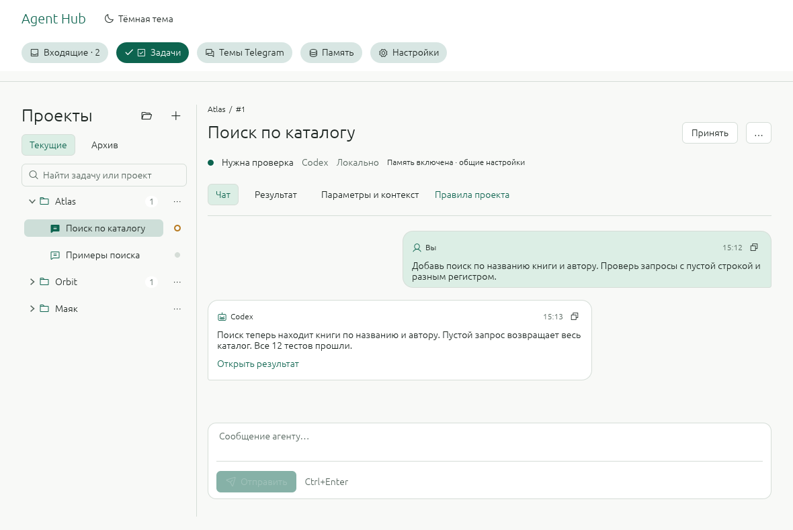

# v1.3.0 — обновлённый настольный интерфейс

В Agent Hub стало проще перейти от поручения к проверке результата. В дереве проектов выберите задачу, прочитайте переписку и откройте изменения прямо из ответа агента. Интерфейс построен на Kylig UI и поддерживает светлую и тёмную темы.



## Задачи и результаты

- У проекта и задачи в дереве свои значки. Ширину дерева можно менять, потянув за границу с чатом. В узком окне дерево открывается кнопкой «Проекты и задачи».
- Ваши сообщения и ответы агента расположены на разных сторонах чата. Сообщение можно скопировать, а из ответа — перейти к изменениям, файлам, проверкам и истории попыток.
- Во «Входящих» есть фильтр по проектам и отдельные карточки для вопросов, разрешений и результатов. У каждой карточки своё действие.
- В форме новой задачи название проекта и путь занимают отдельные строки. Для длинных путей видны ближайшие родительские папки, а при наведении — полный путь. Кнопка «Сменить каталог…» открывает выбор папки.

## Память, агенты и диагностика

- Память доступна из верхней панели. В одном разделе можно выбрать проект, открыть запись и её ревизии, собрать пакет контекста и настроить очистку.
- В настройках агентов можно листать карточки или сразу нажать имя исполнителя. Для пользовательских действий появился предпросмотр меню Telegram, в котором можно проверить команду и рабочий каталог до запуска.
- В диагностике журнал занимает всю ширину окна. События можно искать, отбирать по уровню и копировать. При прокрутке вверх автопрокрутка приостанавливается.
- В разделе «Запуск и обновления» появилась кнопка «Проверить обновления». Она работает и при отключённой автоматической проверке.

[Руководство по задачам](https://github.com/aprazdnikov/agent-hub-rs/blob/v1.3.0/docs/guide/tasks.md) · [Что изменилось с v1.2.0](https://github.com/aprazdnikov/agent-hub-rs/compare/v1.2.0...v1.3.0)

## Обновление

Завершите активные задачи и закройте хаб перед установкой. Чтобы сохранить возможность возврата, при закрытом приложении сделайте копию файла задач `topics.tasks.json` и каталога вложений `task-files/`. Для возврата на v1.1.0 или более раннюю версию потребуется копия, сделанная до перехода на новый формат истории. [Каталоги данных и настроек](https://github.com/aprazdnikov/agent-hub-rs/blob/v1.3.0/docs/guide/settings.md)

## Скачать и проверить

Скачайте файл для своей системы и его контрольную сумму в один каталог.

| Система | Файл | SHA-256 |
|---|---|---|
| Windows x64 | [Установщик .exe](https://github.com/aprazdnikov/agent-hub-rs/releases/download/v1.3.0/agent-hub-x86_64-pc-windows-msvc-setup.exe) · [переносимый .zip](https://github.com/aprazdnikov/agent-hub-rs/releases/download/v1.3.0/agent-hub-x86_64-pc-windows-msvc.zip) | [Установщик](https://github.com/aprazdnikov/agent-hub-rs/releases/download/v1.3.0/agent-hub-x86_64-pc-windows-msvc-setup.exe.sha256) · [архив](https://github.com/aprazdnikov/agent-hub-rs/releases/download/v1.3.0/agent-hub-x86_64-pc-windows-msvc.zip.sha256) |
| macOS, Apple Silicon | [Приложение .app.zip](https://github.com/aprazdnikov/agent-hub-rs/releases/download/v1.3.0/agent-hub-aarch64-apple-darwin.app.zip) | [Сумма](https://github.com/aprazdnikov/agent-hub-rs/releases/download/v1.3.0/agent-hub-aarch64-apple-darwin.app.zip.sha256) |
| macOS, Intel | [Приложение .app.zip](https://github.com/aprazdnikov/agent-hub-rs/releases/download/v1.3.0/agent-hub-x86_64-apple-darwin.app.zip) | [Сумма](https://github.com/aprazdnikov/agent-hub-rs/releases/download/v1.3.0/agent-hub-x86_64-apple-darwin.app.zip.sha256) |
| Debian / Ubuntu x64 | [Пакет .deb](https://github.com/aprazdnikov/agent-hub-rs/releases/download/v1.3.0/agent-hub-x86_64-unknown-linux-gnu.deb) | [Сумма](https://github.com/aprazdnikov/agent-hub-rs/releases/download/v1.3.0/agent-hub-x86_64-unknown-linux-gnu.deb.sha256) |
| Linux x64 с glibc 2.35+ | [Архив .tar.gz](https://github.com/aprazdnikov/agent-hub-rs/releases/download/v1.3.0/agent-hub-x86_64-unknown-linux-gnu.tar.gz) | [Сумма](https://github.com/aprazdnikov/agent-hub-rs/releases/download/v1.3.0/agent-hub-x86_64-unknown-linux-gnu.tar.gz.sha256) |

В каталоге загрузки проверьте сумму перед установкой. Подставьте имя выбранного файла.

- **Linux** — `sha256sum -c agent-hub-x86_64-unknown-linux-gnu.deb.sha256`. Ожидаемый результат — `OK`.
- **macOS** — `shasum -a 256 -c agent-hub-aarch64-apple-darwin.app.zip.sha256`. После `OK` распакуйте архив и замените весь `agent-hub.app`.
- **Windows PowerShell** — следующие команды вернут `True` при совпадении.

  ```powershell
  $file = 'agent-hub-x86_64-pc-windows-msvc-setup.exe'
  $expected = ((Get-Content -Raw -LiteralPath "$file.sha256") -split '\s+')[0]
  (Get-FileHash -Algorithm SHA256 -LiteralPath $file).Hash -eq $expected
  ```
